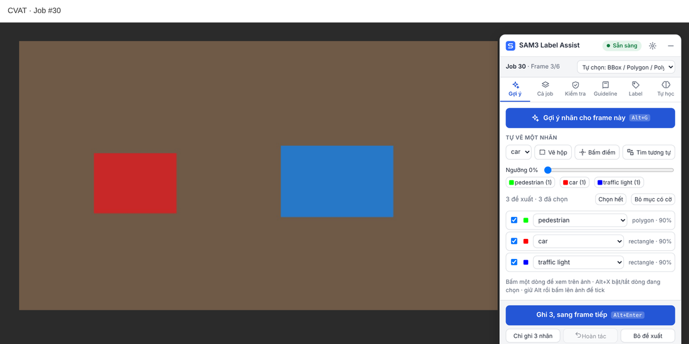
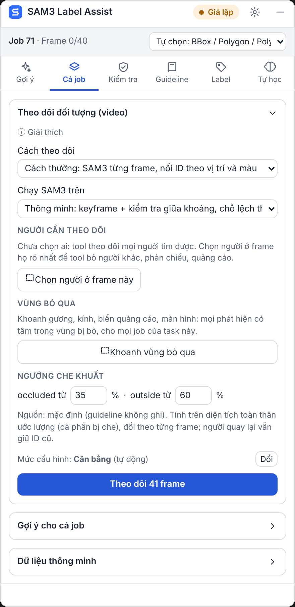
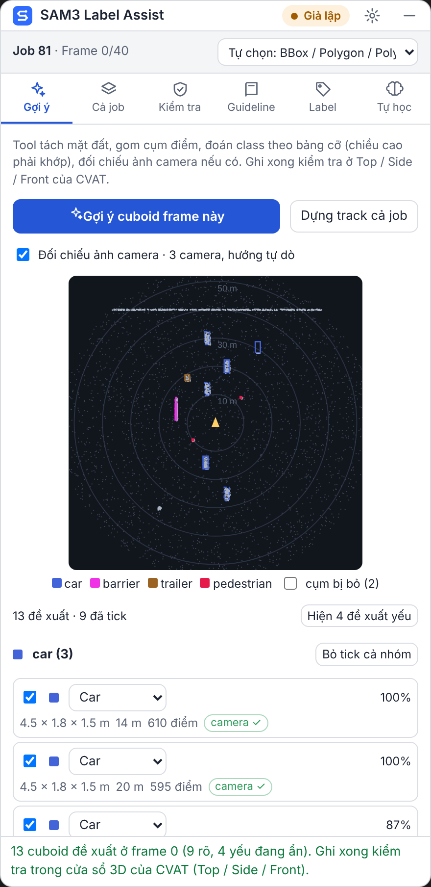
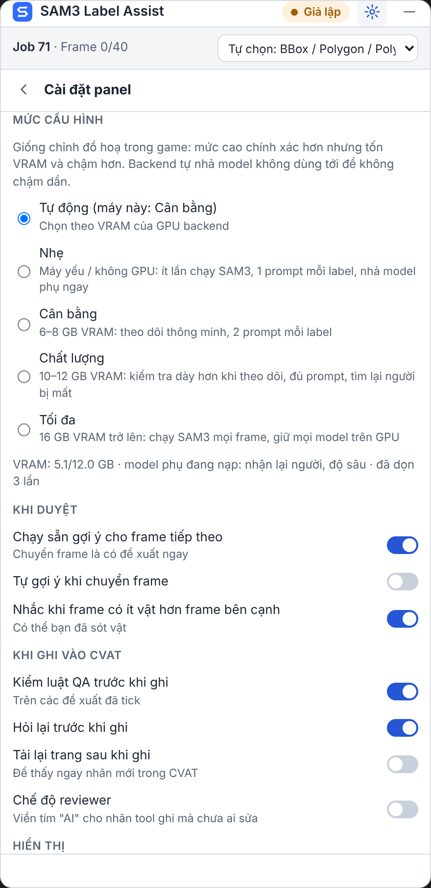
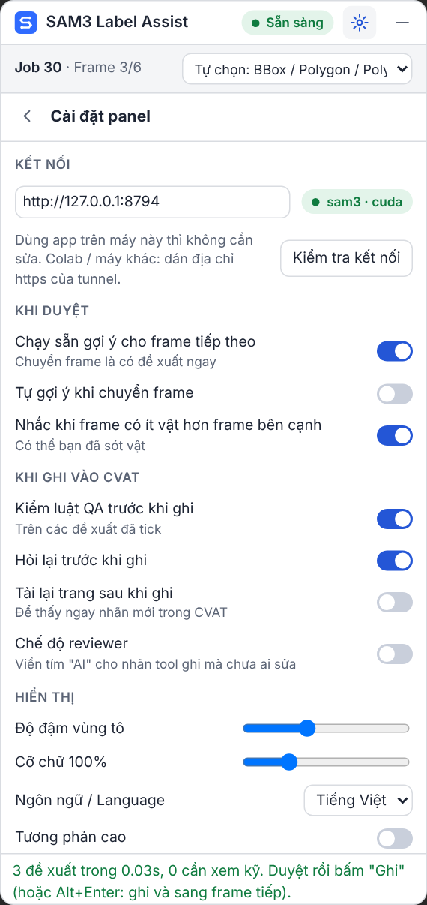
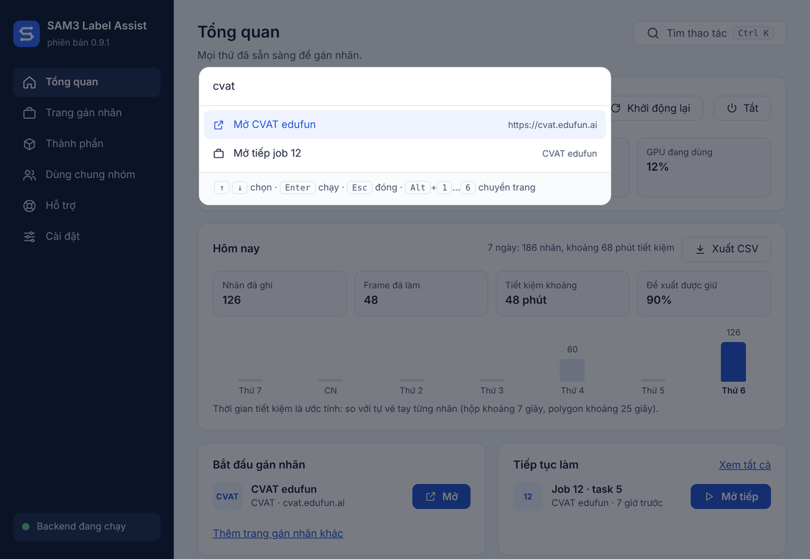
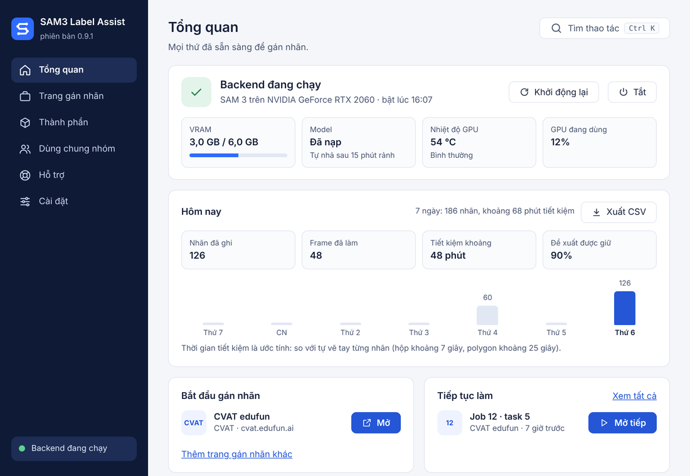

# Hướng dẫn sử dụng SAM3 Label Assist

Dành cho người gán nhãn. Không cần biết lập trình. Đọc khoảng 10 phút.

SAM3 Label Assist **gợi ý** nhãn bằng model SAM 3 ngay trong trang CVAT. Tool không tự ghi gì: bạn duyệt từng đề
xuất rồi mới bấm Ghi.

**Nội dung**

1. [Cài app](#1-cài-app)
2. [Mở CVAT và gán nhãn](#2-mở-cvat-và-gán-nhãn)
3. [Gán cả job một lượt](#3-gán-cả-job-một-lượt)
4. [Phím tắt hay dùng](#4-phím-tắt-hay-dùng)
5. [Bảng điều khiển của app](#5-bảng-điều-khiển-của-app)
6. [Gặp lỗi thì làm gì](#6-gặp-lỗi-thì-làm-gì)
7. [Câu hỏi thường gặp](#7-câu-hỏi-thường-gặp)

---

## 1. Cài app

**Cần có:**

- máy Windows 10 hoặc 11;
- tốt nhất có card NVIDIA, từ 6 GB VRAM;
- trống khoảng 12 GB ổ đĩa;
- một tài khoản Hugging Face đã được Meta duyệt quyền tải SAM 3. Xin quyền ở
  [huggingface.co/facebook/sam3](https://huggingface.co/facebook/sam3); thường được duyệt trong vài giờ.

**Các bước:**

1. Tải `SAM3-Label-Assist-Setup-<bản>.exe` ở trang
   [Releases](https://github.com/11thanh2233/csam-assist/releases) rồi chạy.
2. Máy chưa có Microsoft Visual C++ thì bộ cài tự cài. Windows sẽ hỏi quyền admin: chọn **Yes**.
3. Trình tải thành phần mở ra, đi qua 6 bước:
   1. **Kiểm tra máy:** app tự xem card đồ hoạ, VRAM, driver.
   2. **Giấy phép SAM:** đọc rồi tick đồng ý.
   3. **Token Hugging Face:** dán token loại *Read*. Tạo token ở
      [huggingface.co/settings/tokens](https://huggingface.co/settings/tokens).
   4. **Thành phần:** PyTorch và SAM 3 là bắt buộc. Skeleton người và điểm mặt chỉ cần khi job của bạn có dạng đó.
   5. **Tải và cài:** khoảng 6 GB. Rớt mạng thì bấm **Thử lại**, app tải tiếp từ chỗ dừng.
   6. **Sẵn sàng:** app tự chạy thử SAM 3 trên một ảnh mẫu. Thấy **Mọi thứ hoạt động** là xong.

---

## 2. Mở CVAT và gán nhãn

Mở **SAM3 Label Assist** từ Desktop hoặc menu Start.

**Mở CVAT:**

1. Ở trang **Tổng quan**, mục **Bắt đầu gán nhãn**, bấm **Mở** cạnh trang CVAT của bạn.
2. Lần đầu thì đăng nhập CVAT ngay trong cửa sổ đó. App nhớ đăng nhập cho lần sau.
3. Job bạn đã mở hiện ở mục **Tiếp tục làm**: bấm **Mở tiếp** để quay lại đúng job.

**CVAT chạy trên máy bạn (địa chỉ `localhost`):** CVAT local cần Docker Desktop, mà Docker Desktop chạy trên WSL2. Bấm
**Mở** khi CVAT chưa chạy thì app hiện hộp **CVAT trên máy này chưa chạy**, kiểm tra từng bước:

1. WSL2 đã cài;
2. Docker Desktop đã cài;
3. Docker đang chạy;
4. các container của CVAT đã có;
5. CVAT trả lời.

Bấm **Khởi động CVAT**: app mở Docker Desktop, bật các container CVAT, đợi CVAT sẵn sàng rồi tự mở trang. Lần đầu sau
khi bật máy có thể mất vài phút.

- Thiếu WSL2, Docker Desktop hay CVAT: bấm nút **Cách cài…** cạnh bước đó để mở hướng dẫn chính thức. App không tự cài
  những thứ này vì cần quyền admin và khởi động lại máy.
- Chưa từng chạy CVAT (chưa có container): bấm **Chọn thư mục CVAT**, chọn thư mục bạn đã tải CVAT về (có file
  `docker-compose.yml`). App sẽ chạy `docker compose up -d` trong đó; lần đầu phải tải vài GB.

Mở một job trong CVAT, panel **SAM3** tự hiện ở góc phải.

**Gán từng frame:**

1. Bấm **Gợi ý nhãn cho frame này** (hoặc `Alt+G`). Sau vài giây đề xuất hiện trên ảnh và trong danh sách.
2. **Duyệt danh sách:**
   - Rê chuột vào một dòng để thấy đề xuất đó trên ảnh.
   - Bỏ tick đề xuất sai.
   - Đổi label ở ô chọn trên dòng.
   - **Thuộc tính** chọn ngay trên dòng: giá trị tool hoặc Claude đã chọn sẵn, ô vàng là chỗ bạn cần chọn. Bấm nút
     `occluded` / `visible` để đổi.
   - Dòng có cờ là chỗ tool không chắc, nên xem kỹ.
3. **Sót vật?** Chọn label ở ô cạnh nút **Vẽ hộp**, bấm **Vẽ hộp** rồi kéo hộp quanh vật. **Tìm tương tự** tìm mọi
   vật giống vật trong hộp.
4. **Ghi:** thanh Ghi luôn nằm dưới cùng panel.
   - Nút lớn **Ghi N, sang frame tiếp** (`Alt+Enter`): ghi rồi sang frame sau. Cách này nhanh nhất vì frame sau đã được
     gợi ý sẵn trong lúc bạn duyệt.
   - **Chỉ ghi N nhãn** (`Alt+A`): ghi nhưng ở lại frame này.
5. Sửa tay chỗ cần sửa bằng công cụ của CVAT, rồi `Ctrl+S`.

Ghi nhầm? Bấm **Hoàn tác** ở thanh Ghi (`Alt+Z`), bấm nhiều lần để lùi tiếp.

**Claude xem ảnh (tuỳ chọn):** khi app có Anthropic API key (Cài đặt → AI), ô **Claude xem ảnh** dưới nút Gợi ý bật
sẵn. Mỗi lần gợi ý, Claude xem frame theo guideline của project:

- điền thuộc tính và tag;
- quyết định `occluded` / `outside` theo chính vật và từng bộ phận của skeleton;
- đề nghị bỏ đề xuất guideline không gán (chip **Bỏ?**);
- tìm vật bị sót (chip **Mới thêm**).

Bỏ tick ô đó để không gửi ảnh. Số lần dùng trong ngày hiện ngay cạnh ô; giới hạn đổi trong Cài đặt của app.

**Tool học theo cách bạn chốt:** mỗi lần bấm Ghi, tool nhớ thuộc tính, tag, occluded bạn để lại và đề xuất bạn bỏ.
Ví dụ bạn chọn `fisheye_left` cho vài file tên có `_MVL` thì các ảnh `_MVL` sau tool tự chọn đúng. Xem, viết hoặc
xoá **bài học** của project ở tab **Tự học**, mục **Trí nhớ của project**.

| Chưa có đề xuất | Đang duyệt đề xuất |
|---|---|
|  |  |

---

## 3. Gán cả job một lượt

Tab **Cả job** của panel:

- **Gợi ý cho cả job:** chạy gợi ý lần lượt mọi frame trong khoảng bạn chọn. Mở frame nào là thấy ngay đề xuất của
  frame đó để duyệt. Dừng giữa chừng rồi làm tiếp được, kể cả sau khi đóng CVAT.
- **Theo dõi đối tượng (video):** mỗi vật giữ một ID qua các frame. CVAT tự nội suy giữa các keyframe.

**Theo dõi đúng người (video):** ở tab **Cả job**, mục theo dõi:

1. **Chọn người ở frame này:** tua tới frame người cần theo dõi rõ nhất, kéo hộp quanh người đó. Panel đặt tên P1, P2…
   Chọn đủ người rồi bấm **Theo dõi**: tool chỉ theo dõi những người này, cả trước và sau frame bạn chọn.
2. **Khoanh vùng bỏ qua:** kéo hộp quanh gương, kính xe, biển quảng cáo, màn hình. Mọi phát hiện có tâm trong vùng bị
   bỏ, cho mọi job của task.
3. Duyệt danh sách track: chip **ID?**, **Che?**, **Nhầm?** là chỗ cần xem (bấm chip để đọc giải thích). Track
   không chọn (thường chỉ 1–2 frame) được ẩn; tick **Hiện cả … track không chọn** để xem.

**Ngưỡng che khuất (0.9.6):** tool tính phần trăm diện tích **toàn thân** bị che ở từng frame (cả phần bị che, ước
lượng từ các frame thấy rõ). Từ ngưỡng occluded (mặc định 35%) thì đặt `occluded`, từ ngưỡng outside (mặc định 60%) thì
đặt `outside`; người hiện lại vẫn giữ ID cũ. Guideline có ghi ngưỡng thì tool dùng ngưỡng đó. Sửa ngay ở mục **Ngưỡng
che khuất**, tool nhớ theo task. Bạn vẫn kiểm lại.

**Chạy dở:** theo dõi dừng giữa chừng (bấm Dừng, mất mạng, hết giờ) thì lần sau bấm **Theo dõi** chạy tiếp từ chỗ dở.

**Chạy SAM3 trên:** **Thông minh** (mặc định) chạy SAM3 trên keyframe rồi kiểm tra ở giữa mỗi khoảng; chỗ nội suy lệch
thì tool chạy từng frame, nên đoạn chuyển động phức tạp vẫn đủ chính xác. Chọn **Mọi frame** nếu muốn chạy như bản cũ.

Tab **Kiểm tra** đối chiếu nhãn đã lưu với checklist trong guideline. Nên lưu (`Ctrl+S`) trước khi kiểm tra.

### Job có nhiều loại label: Profile cho project

Job có cả box, skeleton, tag (ví dụ cabin: `person`, `face`, `face13`, tag `frame_meta`), hoặc tab **Label** báo
"profile này chưa gợi ý được", thì tạo **Profile cho project**:

1. Tab **Guideline** → mục **Profile cho project**.
2. Chọn file guideline (`.docx`, `.md`), không bắt buộc. Có guideline thì tool hiểu định nghĩa, kích thước tối thiểu,
   quy ước trái/phải.
3. Bấm **Tạo profile cho project**. Bảng hiện từng label: **Tool gợi ý được**, **Gợi ý được một phần**, **Bạn đánh
   tay**. Mở **Chi tiết** để xem từng điểm skeleton, từng thuộc tính tool tự điền hay để bạn chọn.
4. Bấm **Thử trên frame này**, xem đề xuất. Ổn thì bấm **Lưu cho project**. Mọi job của project tự dùng profile này.

Với polygon và polyline, tool đọc định nghĩa trong guideline để chọn **cách dựng hình** (xem trong **Chi tiết**): gộp các
mảnh thành một vùng (vd crosswalk), vùng mặt đường liền với xe (drivable), mép vùng mặt đường (road_curb), hay đường
giữa vệt sơn (lane).

Tag ảnh (camera, timeofday, weather…) hiện ở đầu danh sách đề xuất: giá trị tool đoán có dòng "tự đoán, kiểm lại",
giá trị bạn phải chọn có dòng "Bạn chọn".

### Job CVAT 3D (cuboid trên point cloud)

Mở job 3D, tab **Gợi ý** đổi thành mục cuboid:

- **Gợi ý cuboid frame này:** tool tách mặt đất (theo từng ô 8 m), gom cụm điểm, đoán class theo bảng kích thước.
  Chiều cao phải khớp bảng; cụm không khớp class nào bị bỏ. Có ảnh camera thì SAM3 đối chiếu thêm.
- Dưới nút là **bản đồ nhìn từ trên** (hướng trước của xe ở trên); bấm một hộp để chọn đề xuất. Đề xuất nhóm theo
  class, xếp theo độ tin; đề xuất yếu ẩn sẵn, bấm **Hiện … đề xuất yếu** để xem.
- **Dựng track cả job:** mỗi vật một track, kích thước khoá theo frame nhiều điểm nhất, bị che tối đa 6 frame thì
  nội suy và bật `occluded`.
- **Công cụ job 3D:**
  - **Kiểm tra dữ liệu job 3D:** số điểm, hệ toạ độ, ảnh camera, vì sao các cụm bị bỏ, việc nên làm;
  - **Tự chỉnh theo cuboid bạn đã đánh:** đánh tay vài frame trước, tool so với cuboid của bạn rồi đề nghị chỉnh số
    điểm, phạm vi, bảng cỡ. Bấm **Áp dụng** mới đổi.
- Tab **Label** của job 3D: sửa bảng cỡ, phạm vi, số điểm tối thiểu, prompt camera cho từng label.
- Cuboid bạn bỏ tick khi ghi được nhớ: lần sau gặp vật cùng class, cùng cỡ thì tool bỏ tick sẵn.

Panel không vẽ được lên cửa sổ 3D. Ghi xong, tải lại trang (F5) rồi kiểm tra ở Top / Side / Front và ảnh camera.

**Cỡ panel:** kéo mép trái panel để đổi độ rộng, mép dưới để đổi chiều cao (bấm đúp mép để về mặc định), hoặc chọn
**Gọn / Vừa / Rộng** trong Cài đặt của panel.

Các tab dài (Cả job, Kiểm tra, Guideline, Tự học) chia thành từng mục: bấm tiêu đề để mở hoặc gập. Panel nhớ mục bạn mở.

**Mức cấu hình (0.9.6):** trong Cài đặt của panel chọn **Tự động / Nhẹ / Cân bằng / Chất lượng / Tối đa**, giống chỉnh
đồ hoạ trong game. Tự động chọn theo VRAM của máy chạy backend. Dưới đó có dòng VRAM đang dùng và các model đang nạp.

**Cài đặt của panel:** bấm nút bánh răng ở góc trên panel. Các tuỳ chọn chia theo nhóm (Kết nối, Khi duyệt, Khi ghi vào
CVAT, Hiển thị), bật tắt bằng công tắc. API key, phím tắt và các tuỳ chọn ít dùng nằm ở mục **Nâng cao**.

---

## 4. Phím tắt hay dùng

**Trong panel (trang CVAT):**

| Phím | Việc |
|---|---|
| `Alt+G` | Gợi ý nhãn cho frame này |
| `Alt+J` / `Alt+K` | Chọn đề xuất tiếp theo / trước |
| `Alt+X` | Tick hoặc bỏ tick đề xuất đang chọn |
| `Alt+Delete` | Loại đề xuất đang chọn |
| `Alt+A` | Ghi các đề xuất đã tick |
| `Alt+Enter` | Ghi rồi sang frame tiếp |
| `Alt+Z` | Hoàn tác lần ghi gần nhất |
| `Alt+P` | Ẩn hoặc hiện panel |
| giữ `Alt` + bấm lên ảnh | Tick đề xuất tại chỗ bấm |

Đổi phím được trong **Cài đặt** của panel (nút bánh răng ở góc panel → **Nâng cao**).

**Trong bảng điều khiển của app:**

| Phím | Việc |
|---|---|
| `Ctrl+K` | Tìm và chạy nhanh mọi thao tác: mở CVAT, bật backend, gửi báo lỗi… |
| `Alt+1` … `Alt+6` | Chuyển trang |
| `Esc` | Đóng hộp thoại (bấm ra ngoài khung cũng đóng) |

---

## 5. Bảng điều khiển của app

Thanh bên trái có 6 trang:

- **Tổng quan:**
  - backend đang chạy hay không, VRAM và nhiệt độ GPU;
  - số nhãn bạn đã ghi hôm nay và thời gian tiết kiệm ước tính;
  - nút **Xuất CSV** để báo cáo với nhóm.
- **Trang gán nhãn:** danh sách trang CVAT; thêm hoặc xoá trang (xoá nhầm thì bấm **Hoàn tác**).
- **Thành phần:** PyTorch, SAM 3… đã cài bản nào, tải hoặc cập nhật. **Trọng số khởi đầu cho model riêng** (tuỳ chọn,
  khoảng 75 MB) giúp model riêng ở tab Tự học học nhanh, không ra 0%.
- **Dùng chung nhóm:** một máy có GPU chia sẻ backend cho các máy khác trong mạng nội bộ.
- **Hỗ trợ:** kiểm tra máy (Windows, ổ đĩa, RAM, Visual C++, WebView2, WSL2, Docker; thiếu thì có nút tải hoặc cài),
  kiểm tra nhanh, gửi báo lỗi, xem nhật ký, sao lưu.
- **Cài đặt:** ngôn ngữ, giao diện sáng hoặc tối, tự chạy cùng Windows, cập nhật, AI soạn guideline.

App tự bật backend khi mở. Nếu backend tắt bất ngờ, app tự bật lại và báo ở khay hệ thống.

---

## 6. Gặp lỗi thì làm gì

1. **Xem trang Tổng quan.** Backend lỗi thì app nói nguyên nhân và các bước sửa, mỗi bước có nút bấm.
   Ví dụ thiếu Microsoft Visual C++ thì có nút **Tải từ Microsoft**.

   

2. **Chạy kiểm tra nhanh.** Vào **Hỗ trợ**, bấm **Chạy kiểm tra** để chắc backend, PyTorch và GPU đều chạy.
3. **Gửi báo lỗi.** Ở trang **Hỗ trợ**:
   1. viết vài dòng lỗi xảy ra lúc nào;
   2. bấm **Tạo gói báo lỗi**;
   3. gửi file zip cho người hỗ trợ.

   Gói báo lỗi không chứa token, mật khẩu hay ảnh của bạn.

   

**Lỗi hay gặp:**

| Hiện tượng | Cách xử lý |
|---|---|
| Panel không hiện trên trang CVAT | Trang đó chưa có trong **Trang gán nhãn**: thêm địa chỉ CVAT vào rồi mở lại. |
| Bấm Gợi ý lâu, báo GPU hết bộ nhớ | Đóng bớt game, trình duyệt nhiều tab, phần mềm đồ hoạ; rồi thử lại. |
| Đề xuất sai class nhiều | Chọn đúng profile ở đầu panel; tab **Label** chỉnh prompt hoặc ngưỡng cho từng label. |
| Windows báo "Windows protected your PC" khi cài | Bấm **More info → Run anyway**. Mã SHA-256 của bộ cài có ghi trong trang Releases. |
| Cập nhật xong app không mở | App tự quay về bản cũ và báo **Đã quay về bản cũ**; dữ liệu vẫn nguyên. Gửi báo lỗi để được sửa. |

---

## 7. Câu hỏi thường gặp

**Ảnh của tôi có bị gửi đi đâu không?**
Không. SAM 3 chạy trên máy bạn, hoặc máy chia sẻ trong nhóm nếu bạn chọn. Chỉ tính năng tạo guideline bằng AI mới gửi
ảnh ra ngoài, và chỉ khi bạn đồng ý. Chi tiết ở [PRIVACY.md](PRIVACY.md).

**Panel báo "Chưa bật AI soạn guideline" là lỗi à?**
Không. Soạn guideline nháp vẫn chạy được không cần AI: tool dùng số liệu quét từ ảnh, guideline mẫu và bài học đã có, còn
định nghĩa class mới thì bạn tự viết. Muốn AI viết giúp:

1. mở app → **Cài đặt** → **AI soạn guideline**;
2. chọn **Claude** rồi dán API key của Anthropic, hoặc chọn **Máy chủ OpenAI** nếu bạn chạy Ollama / LM Studio trên máy;
3. bấm **Kiểm tra**, rồi **Lưu** và **Bật lại backend**.

Key được cất trong Windows Credential Manager. Ảnh mẫu chỉ gửi tới AI khi bạn tick đồng ý trong panel.

**Thời gian tiết kiệm tính thế nào?**
Ước tính so với tự vẽ tay từng nhãn: khoảng 7 giây cho một hộp, 25 giây cho một polygon. Đây là con số tham khảo,
không phải đo chính xác.

**Cập nhật app có mất dữ liệu không?**
Không. Trước mỗi lần cập nhật, app tự sao lưu profile, guideline và dữ liệu tự học vào thư mục `backups`.

**Máy không có card NVIDIA dùng được không?**
Được, nhưng chạy bằng CPU rất chậm. Nên nhờ một máy có GPU trong nhóm bật **Chia sẻ backend**, rồi máy bạn nhập địa
chỉ và key ở trang **Dùng chung nhóm**.
