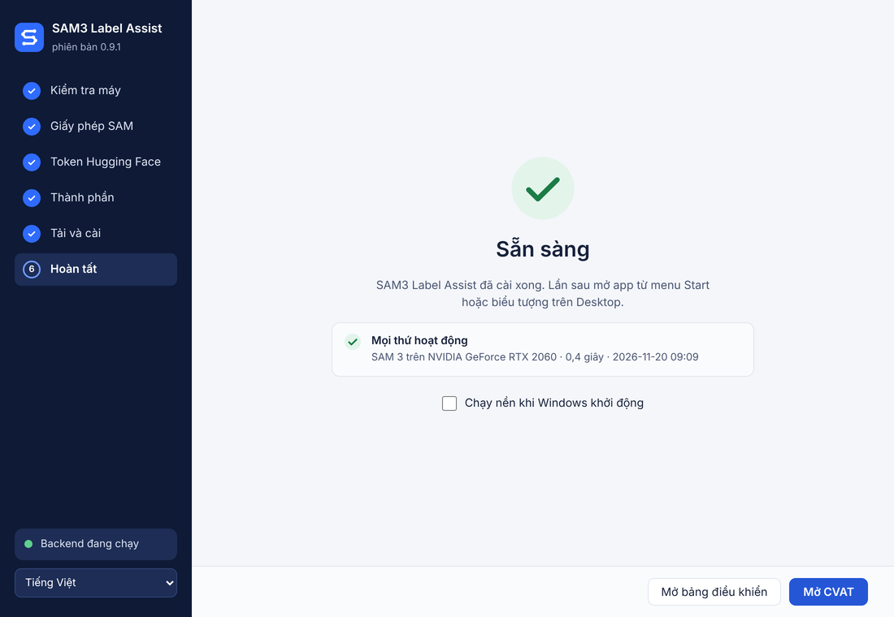
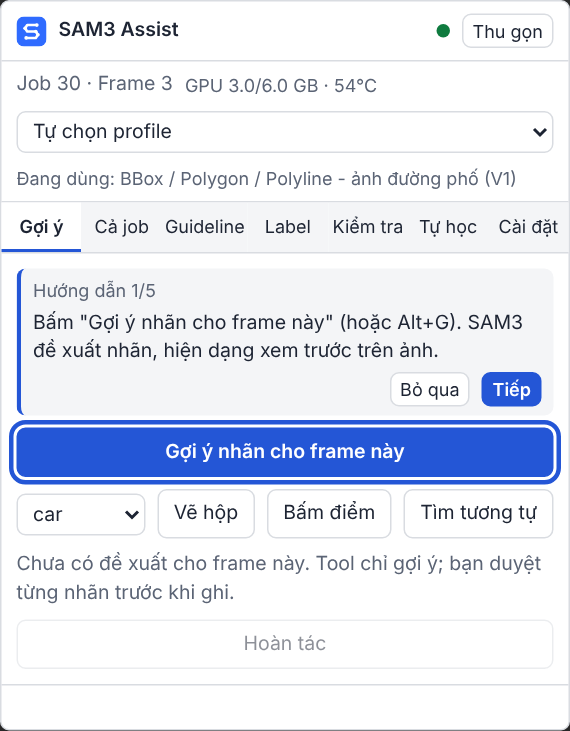
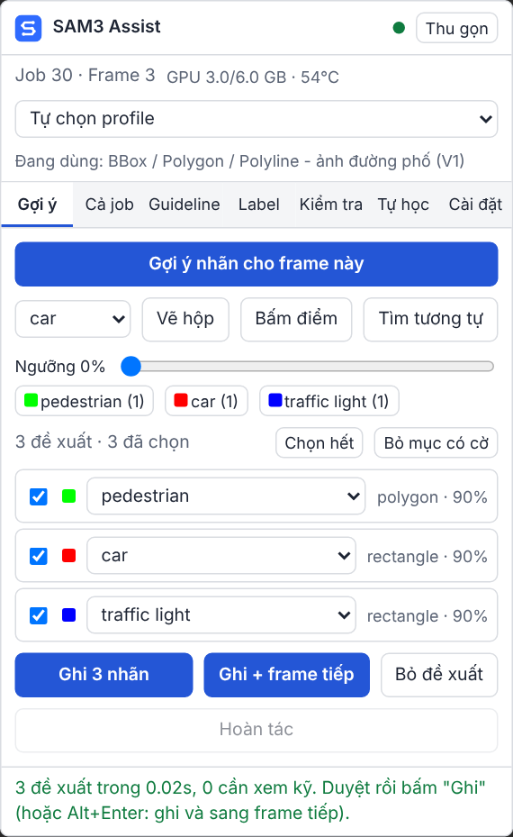
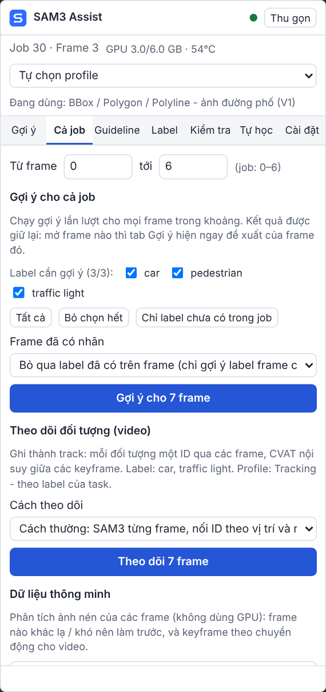
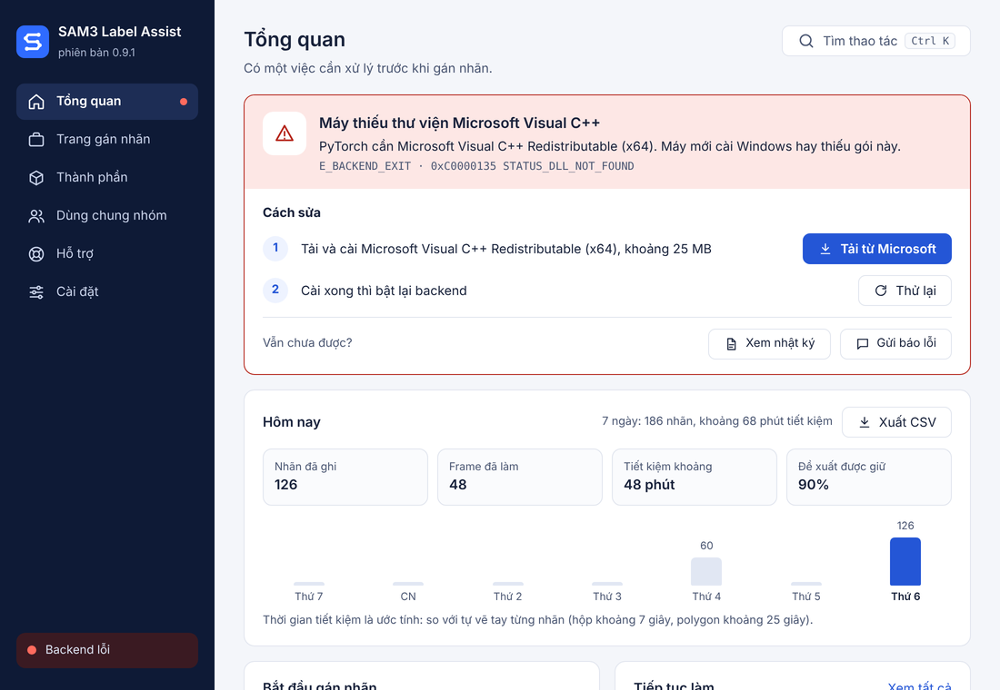
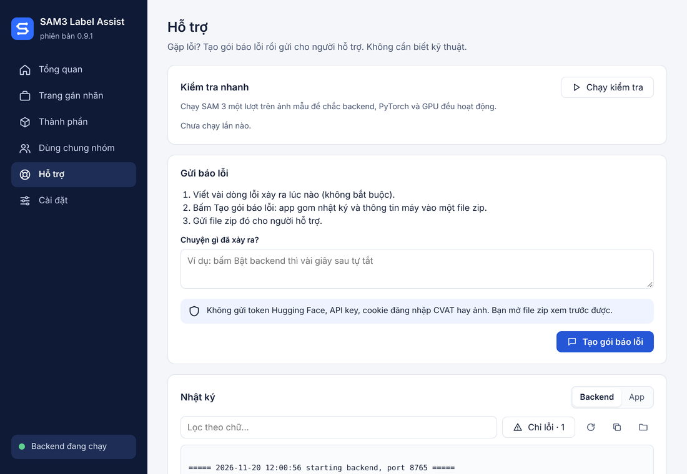

# Hướng dẫn sử dụng SAM3 Label Assist

Dành cho người gán nhãn. Không cần biết lập trình. Đọc khoảng 10 phút.

SAM3 Label Assist **gợi ý** nhãn bằng model SAM 3 ngay trong trang CVAT. Tool không tự ghi gì: bạn duyệt từng đề
xuất rồi mới bấm Ghi.

**Nội dung**

1. [Cài app](#1-cài-app)
2. [Mở CVAT và gán nhãn](#2-mở-cvat-và-gán-nhãn)
3. [Gán cả job một lượt](#3-gán-cả-job-một-lượt)
4. [Phím tắt hay dùng](#4-phím-tắt-hay-dùng)
5. [Bảng điều khiển của app](#5-bảng-điều-khiển-của-app)
6. [Gặp lỗi thì làm gì](#6-gặp-lỗi-thì-làm-gì)
7. [Câu hỏi thường gặp](#7-câu-hỏi-thường-gặp)

---

## 1. Cài app

**Cần có:**

- máy Windows 10 hoặc 11;
- tốt nhất có card NVIDIA, từ 6 GB VRAM;
- trống khoảng 12 GB ổ đĩa;
- một tài khoản Hugging Face đã được Meta duyệt quyền tải SAM 3. Xin quyền ở
  [huggingface.co/facebook/sam3](https://huggingface.co/facebook/sam3); thường được duyệt trong vài giờ.

**Các bước:**

1. Tải `SAM3-Label-Assist-Setup-<bản>.exe` ở trang
   [Releases](https://github.com/11thanh2233/csam-assist/releases) rồi chạy.
2. Máy chưa có Microsoft Visual C++ thì bộ cài tự cài. Windows sẽ hỏi quyền admin: chọn **Yes**.
3. Trình tải thành phần mở ra, đi qua 6 bước:
   1. **Kiểm tra máy:** app tự xem card đồ hoạ, VRAM, driver.
   2. **Giấy phép SAM:** đọc rồi tick đồng ý.
   3. **Token Hugging Face:** dán token loại *Read*. Tạo token ở
      [huggingface.co/settings/tokens](https://huggingface.co/settings/tokens).
   4. **Thành phần:** PyTorch và SAM 3 là bắt buộc. Skeleton người và điểm mặt chỉ cần khi job của bạn có dạng đó.
   5. **Tải và cài:** khoảng 6 GB. Rớt mạng thì bấm **Thử lại**, app tải tiếp từ chỗ dừng.
   6. **Sẵn sàng:** app tự chạy thử SAM 3 trên một ảnh mẫu. Thấy **Mọi thứ hoạt động** là xong.

---

## 2. Mở CVAT và gán nhãn

Mở **SAM3 Label Assist** từ Desktop hoặc menu Start.

**Mở CVAT:**

1. Ở trang **Tổng quan**, mục **Bắt đầu gán nhãn**, bấm **Mở** cạnh trang CVAT của bạn.
2. Lần đầu thì đăng nhập CVAT ngay trong cửa sổ đó. App nhớ đăng nhập cho lần sau.
3. Job bạn đã mở hiện ở mục **Tiếp tục làm**: bấm **Mở tiếp** để quay lại đúng job.

Mở một job trong CVAT, panel **SAM3** tự hiện ở góc phải.

**Gán từng frame:**

1. Bấm **Gợi ý nhãn cho frame này** (hoặc `Alt+G`). Sau vài giây đề xuất hiện trên ảnh và trong danh sách.
2. **Duyệt danh sách:**
   - Rê chuột vào một dòng để thấy đề xuất đó trên ảnh.
   - Bỏ tick đề xuất sai.
   - Đổi label ở ô chọn trên dòng.
   - Dòng có cờ là chỗ tool không chắc, nên xem kỹ.
3. **Sót vật?** Chọn label ở ô cạnh nút **Vẽ hộp**, bấm **Vẽ hộp** rồi kéo hộp quanh vật. **Tìm tương tự** tìm mọi
   vật giống vật trong hộp.
4. **Ghi:** bấm **Ghi N nhãn** (`Alt+A`), hoặc **Ghi + frame tiếp** (`Alt+Enter`). Ghi + frame tiếp nhanh hơn vì
   frame sau đã được gợi ý sẵn trong lúc bạn duyệt.
5. Sửa tay chỗ cần sửa bằng công cụ của CVAT, rồi `Ctrl+S`.

Ghi nhầm? Bấm **Hoàn tác** (`Alt+Z`), bấm nhiều lần để lùi tiếp.

| Chưa có đề xuất | Đang duyệt đề xuất |
|---|---|
|  |  |

---

## 3. Gán cả job một lượt

Tab **Cả job** của panel:

- **Gợi ý cho cả job:** chạy gợi ý lần lượt mọi frame trong khoảng bạn chọn. Mở frame nào là thấy ngay đề xuất của
  frame đó để duyệt. Dừng giữa chừng rồi làm tiếp được, kể cả sau khi đóng CVAT.
- **Theo dõi đối tượng (video):** mỗi vật giữ một ID qua các frame. CVAT tự nội suy giữa các keyframe.

Tab **Kiểm tra** đối chiếu nhãn đã lưu với checklist trong guideline. Nên lưu (`Ctrl+S`) trước khi kiểm tra.

---

## 4. Phím tắt hay dùng

**Trong panel (trang CVAT):**

| Phím | Việc |
|---|---|
| `Alt+G` | Gợi ý nhãn cho frame này |
| `Alt+J` / `Alt+K` | Chọn đề xuất tiếp theo / trước |
| `Alt+X` | Tick hoặc bỏ tick đề xuất đang chọn |
| `Alt+Delete` | Loại đề xuất đang chọn |
| `Alt+A` | Ghi các đề xuất đã tick |
| `Alt+Enter` | Ghi rồi sang frame tiếp |
| `Alt+Z` | Hoàn tác lần ghi gần nhất |
| `Alt+P` | Ẩn hoặc hiện panel |
| giữ `Alt` + bấm lên ảnh | Tick đề xuất tại chỗ bấm |

Đổi phím được ở tab **Cài đặt** của panel.

**Trong bảng điều khiển của app:**

| Phím | Việc |
|---|---|
| `Ctrl+K` | Tìm và chạy nhanh mọi thao tác: mở CVAT, bật backend, gửi báo lỗi… |
| `Alt+1` … `Alt+6` | Chuyển trang |
| `Esc` | Đóng hộp thoại (bấm ra ngoài khung cũng đóng) |

---

## 5. Bảng điều khiển của app

Thanh bên trái có 6 trang:

- **Tổng quan:**
  - backend đang chạy hay không, VRAM và nhiệt độ GPU;
  - số nhãn bạn đã ghi hôm nay và thời gian tiết kiệm ước tính;
  - nút **Xuất CSV** để báo cáo với nhóm.
- **Trang gán nhãn:** danh sách trang CVAT; thêm hoặc xoá trang (xoá nhầm thì bấm **Hoàn tác**).
- **Thành phần:** PyTorch, SAM 3… đã cài bản nào, tải hoặc cập nhật.
- **Dùng chung nhóm:** một máy có GPU chia sẻ backend cho các máy khác trong mạng nội bộ.
- **Hỗ trợ:** kiểm tra nhanh, gửi báo lỗi, xem nhật ký, sao lưu.
- **Cài đặt:** ngôn ngữ, giao diện sáng hoặc tối, tự chạy cùng Windows, cập nhật.

App tự bật backend khi mở. Nếu backend tắt bất ngờ, app tự bật lại và báo ở khay hệ thống.

---

## 6. Gặp lỗi thì làm gì

1. **Xem trang Tổng quan.** Backend lỗi thì app nói nguyên nhân và các bước sửa, mỗi bước có nút bấm.
   Ví dụ thiếu Microsoft Visual C++ thì có nút **Tải từ Microsoft**.

   

2. **Chạy kiểm tra nhanh.** Vào **Hỗ trợ**, bấm **Chạy kiểm tra** để chắc backend, PyTorch và GPU đều chạy.
3. **Gửi báo lỗi.** Ở trang **Hỗ trợ**:
   1. viết vài dòng lỗi xảy ra lúc nào;
   2. bấm **Tạo gói báo lỗi**;
   3. gửi file zip cho người hỗ trợ.

   Gói báo lỗi không chứa token, mật khẩu hay ảnh của bạn.

   

**Lỗi hay gặp:**

| Hiện tượng | Cách xử lý |
|---|---|
| Panel không hiện trên trang CVAT | Trang đó chưa có trong **Trang gán nhãn**: thêm địa chỉ CVAT vào rồi mở lại. |
| Bấm Gợi ý lâu, báo GPU hết bộ nhớ | Đóng bớt game, trình duyệt nhiều tab, phần mềm đồ hoạ; rồi thử lại. |
| Đề xuất sai class nhiều | Chọn đúng profile ở đầu panel; tab **Label** chỉnh prompt hoặc ngưỡng cho từng label. |
| Windows báo "Windows protected your PC" khi cài | Bấm **More info → Run anyway**. Mã SHA-256 của bộ cài có ghi trong trang Releases. |
| Cập nhật xong app không mở | App tự quay về bản cũ và báo **Đã quay về bản cũ**; dữ liệu vẫn nguyên. Gửi báo lỗi để được sửa. |

---

## 7. Câu hỏi thường gặp

**Ảnh của tôi có bị gửi đi đâu không?**
Không. SAM 3 chạy trên máy bạn, hoặc máy chia sẻ trong nhóm nếu bạn chọn. Chỉ tính năng tạo guideline bằng AI mới gửi
ảnh ra ngoài, và chỉ khi bạn đồng ý. Chi tiết ở [PRIVACY.md](PRIVACY.md).

**Thời gian tiết kiệm tính thế nào?**
Ước tính so với tự vẽ tay từng nhãn: khoảng 7 giây cho một hộp, 25 giây cho một polygon. Đây là con số tham khảo,
không phải đo chính xác.

**Cập nhật app có mất dữ liệu không?**
Không. Trước mỗi lần cập nhật, app tự sao lưu profile, guideline và dữ liệu tự học vào thư mục `backups`.

**Máy không có card NVIDIA dùng được không?**
Được, nhưng chạy bằng CPU rất chậm. Nên nhờ một máy có GPU trong nhóm bật **Chia sẻ backend**, rồi máy bạn nhập địa
chỉ và key ở trang **Dùng chung nhóm**.
